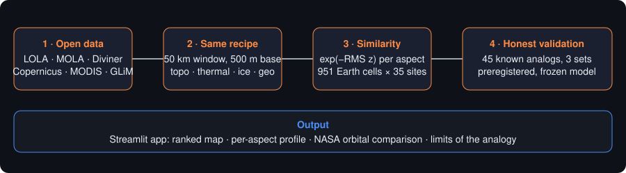
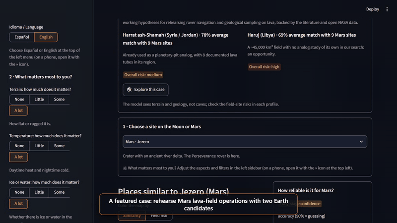
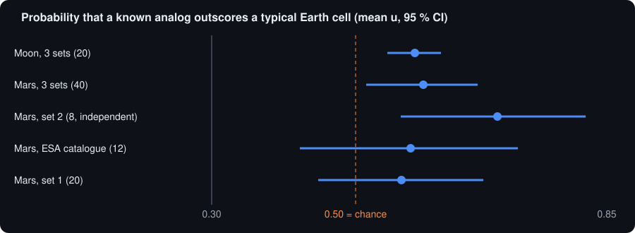
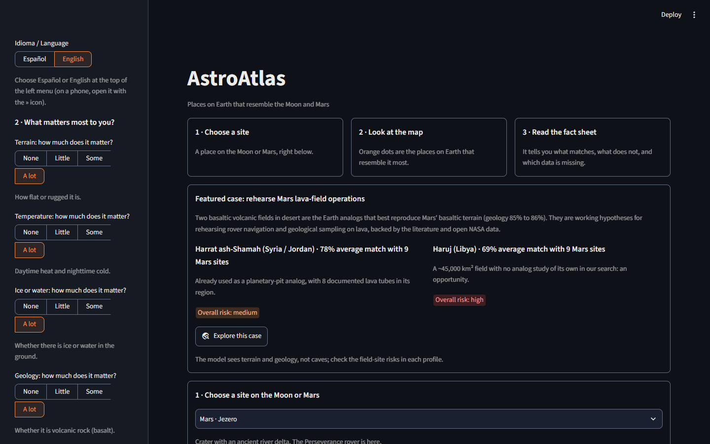
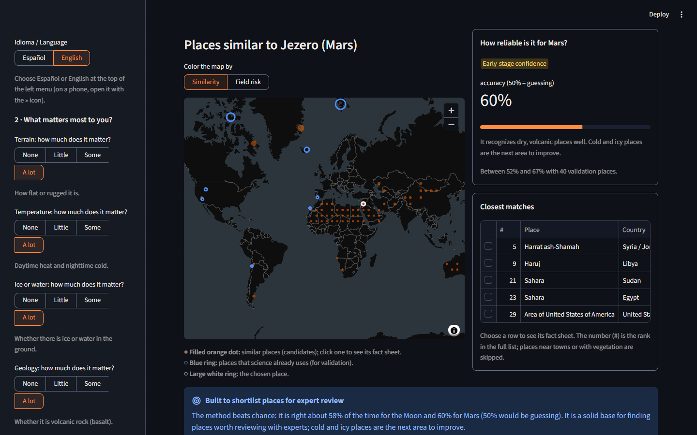
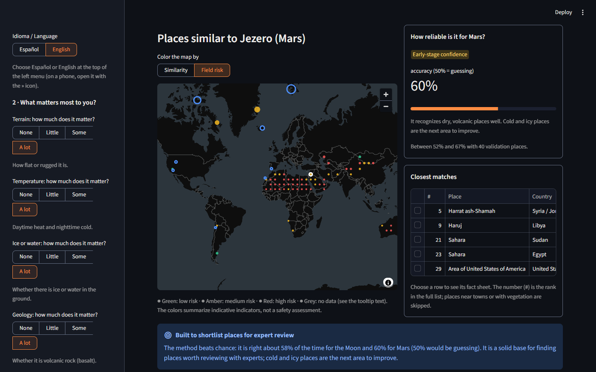
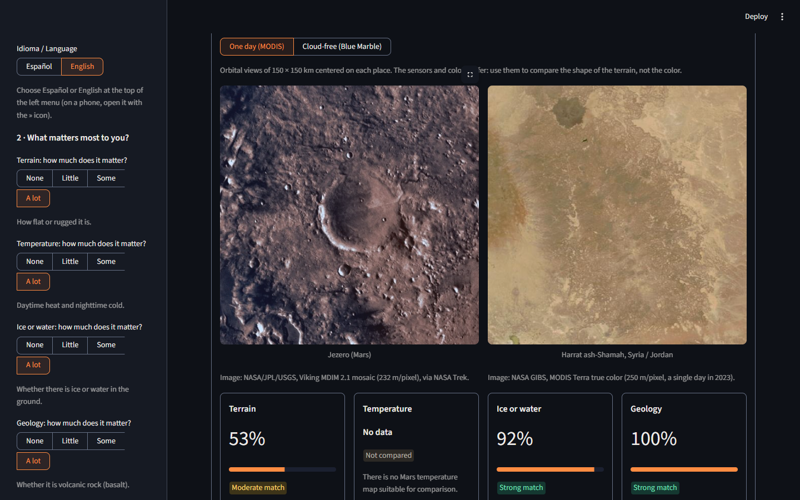
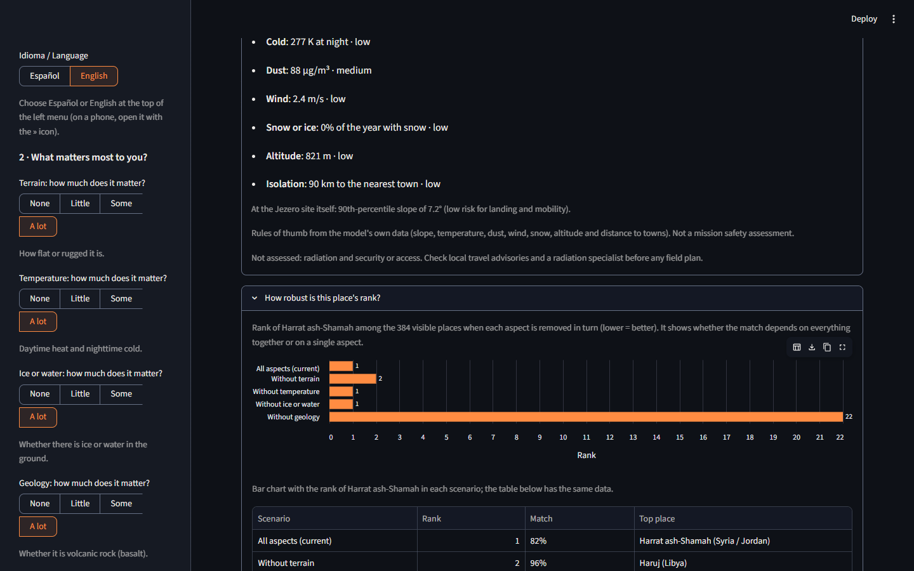
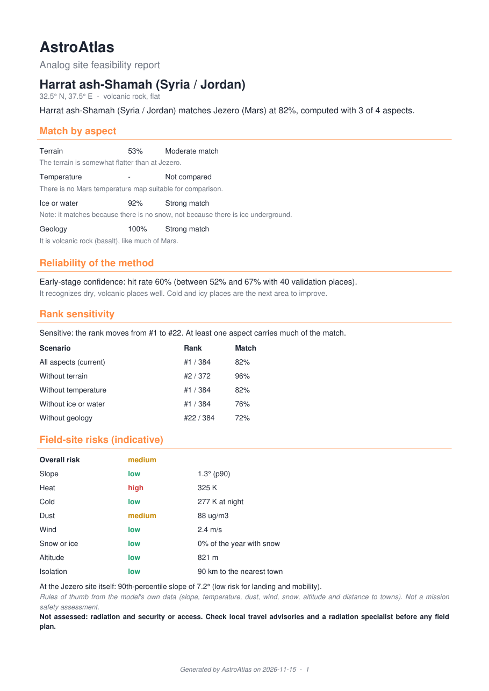
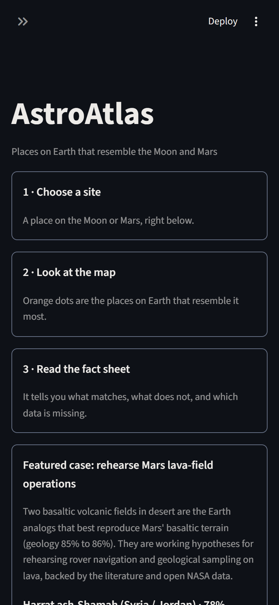

# 🌍🌕🔴 AstroAtlas: finding Earth analogs for Moon and Mars bases

**NASA Space Apps Challenge 2026 · *Permanent Moon Base Locations and Mars***

AstroAtlas ranks places on Earth by how closely they resemble candidate sites on the Moon and Mars (terrain, temperature, ice/water and geology) and then **tests itself, honestly, against terrestrial analogs that scientists already use**. The result is a reproducible method, a public web app, and a clear map of where the method works and where it does not.

[](https://github.com/dorelysm/AstroAtlas-Hackaton-NASA-2026/actions/workflows/ci.yml)

### 👉 [Open the live app](https://app-production-6cc653bd.up.railway.app/?lang=en) · available in English and Spanish



### 🎬 See it in action

[](https://youtu.be/K_QtqzqOx6U)

**[▶ Watch the full demo on YouTube](https://youtu.be/K_QtqzqOx6U)** · [MP4 download](https://github.com/dorelysm/AstroAtlas-Hackaton-NASA-2026/releases/download/v1.0/astroatlas-demo.mp4)

*Silent demo. The GIF shows (click it to open the video on YouTube) the featured case, the map and a place profile with NASA orbital views; **the full 85-second video** (field-risk map, sensitivity check, PDF site report, filters and English/Spanish).*

---

## The idea in 60 seconds

| | |
|---|---|
| **Question** | Which places on Earth are good analogs for a Moon or Mars site, in *which aspects*, and where does the analogy break down? |
| **Method** | 35 target sites (21 Moon, 14 Mars) and 951 Earth cells are described with the same four aspects, over the same 50 km window and 500 m baseline. Similarity per aspect = `exp(−RMS z)`; the global score is a weighted mean of the aspects that have data. |
| **Honesty** | Known analogs only **validate**, never tune. Protocols and success criteria are **preregistered** (written, hashed and frozen before measuring). Negative results are published. |
| **Output** | A ranked, explained map for any target site, orbital imagery side by side (NASA), per-aspect confidence labels, use-case profiles and candidate profiles. |

---

## How AstroAtlas answers the five judging criteria

### 🌍 Impact
- **Gives mission teams a transparent shortlist tool**, not a black box: pick a Moon or Mars site, see the most similar Earth places, and read *what is similar, what is not, which data are missing and where the analogy fails* (gravity, atmosphere, radiation).
- **Reports its own reliability.** Pooled over 40 Mars and 20 Moon analogs, the method ranks a known analog above a typical Earth cell **≈ 60 % (Mars) and 58 % (Moon) of the time, against 50 % for chance**: a solid base for shortlisting. The app shows that number and its interval next to every result.
- **Reusable assets:** a frozen validation set of 45 analogs with provenance, a data contract for Earth/Moon/Mars features, and every experiment with its verdict, useful to anyone who wants to improve analog selection.

### 💡 Creativity
- **Multi-aspect, not one score.** The challenge says a place can be a great geological analog and a poor thermal one; AstroAtlas scores and labels each aspect separately (the *aspect atlas*).
- **Same data recipe on three bodies**, and a visual comparison built live from NASA services: Mars (Viking MDIM) or Moon (LRO WAC) next to the Earth place (MODIS / Blue Marble), at the same 150 km scale.
- **Self-auditing science:** eleven improvement ideas were preregistered and tested; only one survived, and only for the cold use case. Two candidate flaws were found by the project itself (rainforests proposed as "Mars-like"; flat ice sheets proposed as "Moon-like") and fixed or flagged.

### ✅ Validity
- **Three independent analog sets (45 sites):** a first set (23), a second set fixed before measuring (9), and 13 sites taken mechanically from the **ESA expert catalogue of planetary analogues**.
- **Preregistered, frozen-model evaluation** with bootstrap intervals over the analogs (the independent unit). Hashes of the protocols and lists are recorded in the documents.
- **Controls against known biases:** a flat-terrain control showed that an apparent topographic signal was just "craters sit on flat cratons"; a novelty check shows Harrat ash-Shamah is *already* studied as a planetary-pit analog.
- **A clear roadmap:** the validation shows exactly what to improve next (cold and ice analogs, Mars thermal data, verified analog coordinates, final licence checks); see [Future work](#future-work).
- **217 automated tests** (including a browserless smoke test of the app) run on every push; the app runs from versioned demo data with no downloads.



| Pooled validation (3 sets) | Mean u | 95 % CI | Reading |
|---|---|---|---|
| Moon (20 analogs) | 0.583 | 0.545 – 0.619 | above chance, consistent across sets |
| Mars (40 analogs) | 0.595 | 0.515 – 0.670 | above chance; the independent second set reaches 0.698 |

Strongest on **arid, volcanic and impact** analogs (Lanzarote 0.96, Pinacate 0.79, Atacama 0.65). **Cold, ice, hydrothermal and lake** analogs (Dry Valleys, Svalbard) are the next area to improve, and [we explain why](docs/validation/extended-validation.md).

### 🪐 Relevance
Directly built on the challenge text: open NASA Earth/Moon/Mars data (LOLA, MOLA, Diviner, Lunar Prospector & Odyssey GRS, MODIS, MERRA-2, SEDAC) plus ESA Copernicus DEM, USGS and open catalogues; **several dimensions of analogy** (topography, temperature, ice/water, geology, plus context on vegetation, settlements, dust/wind, caves and lava tubes); **scale awareness** (50 km windows and a 0.25° zoom); a **systematic search** beyond famous sites; and explicit **limits of Earth as an analog**.

**Two candidates for Mars**, with caveats: **Harrat ash-Shamah** (Syria/Jordan), a basaltic plateau with 8 documented lava tubes in the same region and previous study for planetary pits, and **Haruj** (Libya), a ~45,000 km² volcanic field with no analog study found in our preregistered search. Both are *hypotheses for expert review*, not discoveries. For the Moon the method finds no credible candidates, and says so.

### 🎤 Presentation
- A guided three-step app: *choose a site → read the map → read the profile*, with a plain-language glossary, percentages instead of raw scores, and accessibility fixes (language attribute, headings, contrast, keyboard, mobile layout).
- Everything is documented in English: [report](docs/report.md), [challenge text](docs/challenge.md), methods, results and every experiment.
- Bilingual interface (English / Spanish) with a sidebar selector and shareable `?lang=` links.

---

## What the app shows

0. **Start from the featured case** (rehearsing Mars lava-field operations at Harrat ash-Shamah and Haruj) with one click.
1. **Pick a Moon or Mars site**, set how much each aspect matters, and narrow the results by **world region** or **volcanic terrain**.
2. **See an interactive map** of the most similar Earth places (named, with country), the known analogs for comparison, and a confidence panel.
3. **Open a place profile:** match per aspect with a one-line explanation, side-by-side NASA orbital views, and *what Earth cannot imitate*.
4. **Check robustness and risks:** a *sensitivity chart* shows how the place's rank changes when each aspect is removed in turn; *field-site risk indicators* (slope, heat, cold, dust, wind, snow, altitude, isolation) can also colour the map; and a **PDF site report** summarises the profile, reliability, risks and orbital views.
5. **Go deeper:** aspect atlas, use-case profiles (mobility, cold operations, ice, basaltic terrain, lava tubes), technical details and credits.

| Home and featured case | Map by similarity | Map by field-site risk |
|---|---|---|
|  |  |  |

| Place profile with NASA orbital views | Risks and rank sensitivity | PDF site report | Mobile |
|---|---|---|---|
|  |  |  |  |

*Jezero (Mars, NASA Viking MDIM 2.1 mosaic) next to Harrat ash-Shamah (Earth, MODIS), both at 150 × 150 km. Imagery: NASA GIBS and NASA Trek.*

## Quick start

```bash
git clone https://github.com/dorelysm/AstroAtlas-Hackaton-NASA-2026.git
cd AstroAtlas-Hackaton-NASA-2026
python -m venv .venv && source .venv/bin/activate        # Windows: .venv\Scripts\Activate.ps1
pip install -e ".[app,dev]"
streamlit run app/streamlit_app.py                        # runs on the versioned demo_data/, no downloads
pytest                                                    # 217 tests
```

Reproduce the results: `python -m astroatlas.pipeline` (scores, validation, candidates). Regenerating the raw features needs the `[data]` extra and an Earthdata account (`.env.example`); every data module and experiment is listed in [docs/README.md](docs/README.md#reproducing-everything).

## Repository layout

| Path | Contents |
|---|---|
| `app/` | Streamlit app (`streamlit_app.py`) |
| `src/astroatlas/` | Package: similarity model, validation, experiments, i18n, imagery |
| `src/astroatlas/data/` | Data readers per body (PDS, Copernicus, MODIS, GLiM, SEDAC…) |
| `tests/` | 217 automated tests |
| `demo_data/` | Small versioned features and results so the app runs anywhere |
| `docs/` | [Documentation index](docs/README.md): report, validation, preregistrations, data sources, licences, catalogues |
| `docs/catalog/` | CSV catalogues of targets, landings and analog sets (frozen lists with hashes) |
| `.streamlit/`, `railway.json` | Theme and deployment configuration |

## Documentation highlights

- 📄 [Full technical report](docs/report.md)
- 🧪 [All preregistered experiments](docs/preregistrations/) and [validation](docs/validation/)
- 🗺️ [Candidate profiles](docs/results/candidate-profiles.md) · [Aspect atlas](docs/results/aspect-atlas.md) · [Use cases](docs/results/use-cases.md)
- 📚 [Data provenance](docs/reference/data-sources.md) · [Licences](docs/reference/licenses.md)
- 🖥️ [Interface, accessibility and deployment](docs/app/interface.md)

## Data sources

All model inputs are open data. Full provenance, URLs, confidence levels and licences: [data-sources](docs/reference/data-sources.md) · [licences](docs/reference/licenses.md).

### NASA

| Data | Mission / product | Used for | Source |
|---|---|---|---|
| Moon topography | LRO **LOLA** LDEM (PDS Geosciences) | Slope, roughness, relief | [PDS](https://pds-geosciences.wustl.edu/lro/lro-l-lola-3-rdr-v1/lrolol_1xxx/data/lola_gdr/cylindrical/img/) |
| Moon temperature | LRO **Diviner** Global Cumulative Products | Maximum temperature and daily range | [PDS](https://pds-geosciences.wustl.edu/lro/urn-nasa-pds-lro_diviner_derived1/data_derived_gcp/) |
| Moon polar ice | LRO **Diviner** Polar Resource Product | Stable-ice fraction (poles only) | [PDS](https://pds-geosciences.wustl.edu/lro/urn-nasa-pds-lro_diviner_derived1/data_derived_prp/) |
| Moon composition | **Lunar Prospector** GRS | FeO → basalt proxy | [PDS](https://pds-geosciences.wustl.edu/lunar/lp-l-grs-5-elem-abundance-v1/lp_9001/data/) |
| Mars topography | MGS **MOLA** MEGDR (PDS Geosciences) | Slope, roughness, relief | [PDS](https://pds-geosciences.wustl.edu/mgs/mgs-m-mola-5-megdr-l3-v1/mgsl_300x/meg128/) |
| Mars water / iron | **Mars Odyssey** GRS elemental maps | Ice/water fraction, basalt proxy | [PDS](https://pds-geosciences.wustl.edu/ody/ody-m-grs-5-elements-v1/odgm_xxxx/data/smoothed/) |
| Mars polar hydrogen | **Mars Odyssey** GRS neutron data | Ice-rich classes, polar targets | [DOI](https://doi.org/10.17189/1522868) |
| Mars thermal inertia | **MGS TES** thermal-inertia maps | Tested experiment (not adopted) | [PDS](https://pds-geosciences.wustl.edu/mgs/mgs-m-tes-5-timap-v1/mgst_9001/data/) |
| Earth temperature | **MODIS** Terra LST (MOD11C3) | Surface temperature | [LP DAAC](https://lpdaac.usgs.gov/products/mod11c3v061/) |
| Earth snow cover | **MODIS** Terra (MOD10CM, NSIDC) | Ice/water proxy | [NSIDC](https://nsidc.org/data/mod10cm) |
| Earth vegetation | **MODIS** Terra NDVI (MOD13C2) | Vegetation flag | [LP DAAC](https://lpdaac.usgs.gov/products/mod13c2v061/) |
| Earth dust and wind | **MERRA-2** (GES DISC) | Descriptive context | [GMAO](https://gmao.gsfc.nasa.gov/reanalysis/MERRA-2/) |
| Earth soil moisture | **GLDAS** Noah (GES DISC) | Diagnostic (tested, not adopted) | [GLDAS](https://ldas.gsfc.nasa.gov/gldas) |
| Population | **SEDAC** GRUMP v1 | Settlement-proximity flag | [DOI](https://doi.org/10.7927/H4BC3WG1) |
| Orbital imagery | **GIBS** (MODIS, Blue Marble) and **Trek** (Viking MDIM 2.1, LRO WAC) | Visual comparison in the app | [GIBS](https://earthdata.nasa.gov/gibs) · [Trek](https://trek.nasa.gov/) |
| Landing coordinates | LROC tables (LRO), Mars Orbital Data Explorer | Target sites | [LROC](https://lroc.im-ldi.com/) · [ODE](https://ode.rsl.wustl.edu/mars/pagehelp/Content/Missions_Instruments/Landing_Sites.htm) |

### ESA and other agencies and organisations

| Data | Source | Used for | Link |
|---|---|---|---|
| Earth topography | **ESA / European Commission** Copernicus DEM GLO-90 | Earth slope, roughness, relief | [AWS Open Data](https://registry.opendata.aws/copernicus-dem/) |
| Analog catalogue | **ESA** *Catalogue of Planetary Analogues* (CAFE project) | Third validation set (13 sites) | [PDF](https://freight.cargo.site/m/D1821053255089660420449933921929/The-Catalogue-of-Planetary-Analogues.pdf) |
| Permafrost map | **ESA GlobPermafrost** (Obu et al. 2018) | Cold use case | [PANGAEA](https://doi.org/10.1594/PANGAEA.888600) |
| Analog sites and craters | **USGS** Astrogeology analog layer | Aspect validation | [DOI](https://doi.org/10.5066/P9J72921) |
| Mars cave candidates | **USGS** Mars Global Cave Candidate Catalog | Context | [USGS](https://www.usgs.gov/center-news/caves-mars) |
| Earth lithology | **GLiM** (Hartmann & Moosdorf 2012) | Basalt fraction | [PANGAEA](https://doi.org/10.1594/PANGAEA.788537) |
| Lunar pits | Zenodo catalogue (LROC-based) | Context | [Zenodo](https://doi.org/10.5281/zenodo.20516852) |
| Terrestrial lava tubes | Pyroduct Digital Catalog | Context | [Zenodo](https://doi.org/10.5281/zenodo.14535886) |
| Place names | Natural Earth | Place and country names | [naturalearthdata.com](https://www.naturalearthdata.com/) |

CNSA, ISRO and JAXA missions (Chang'e, Chandrayaan, SLIM) appear only as landing-site coordinates, taken from NASA/LROC and secondary sources, not as data products.

## Future work

The validation is also a map of what to do next. Everything below is documented, with its evidence, in the [report](docs/report.md).

- **Cold and ice analogs:** add a physical dryness/ground-ice variable with a Mars counterpart (the preregistered permafrost map is a first step) and more shallow-ice targets.
- **Mars temperature:** a comparable thermal product (for example from MRO MCS) to give Mars a fourth, thermal dimension.
- **More and better analogs:** extend the frozen validation sets with primary-source coordinates (several still come from Wikipedia) so intervals tighten.
- **Risk layer:** add radiation and security/access data, which the current field-risk indicators deliberately leave unassessed.
- **Cells with data gaps:** an optional, off-by-default scoring mode (`missing="zero"`) is ready to test on the frozen validation sets 2 and 3; its [draft protocol](docs/preregistrations/missing-dimensions.md) sets the adoption criterion before anything is measured, so the published model stays unchanged until then.
- **Licences:** Copernicus, SEDAC, MODIS (LST and snow), GIBS and the USGS cave catalogue are checked and cited in [licences](docs/reference/licenses.md); next, copy the PDS bundle DOIs and look for explicit Trek terms.
- **Scope of the analogy:** Earth cannot reproduce reduced gravity, lunar vacuum, Mars' thin atmosphere or radiation; the profiles say so for every place.

Parts of the literature search and code were produced with **AI assistants** and reviewed by the team.

## License

Code: [MIT](LICENSE). Documentation and derived results: [CC BY 4.0](docs/LICENSE.md). Third-party data keep their own licences ([details](docs/reference/licenses.md)).

## Credits

Developed by the **AstroAtlas team** for the **NASA Space Apps Challenge 2026**. Data and imagery: NASA (PDS, MODIS, MERRA-2, SEDAC, GIBS, Trek), ESA (Copernicus DEM, CAFE catalogue), USGS, GLiM (Hartmann & Moosdorf 2012), Obu et al. (2018), Natural Earth, Zenodo catalogues. This project is not endorsed by NASA.
